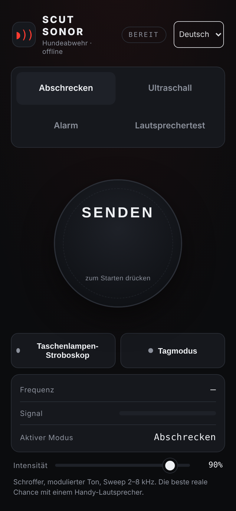
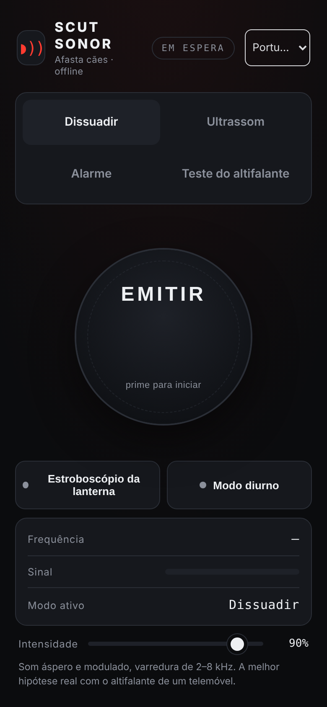

# SCUT SONOR

[English](README.md) · [Română](README.ro.md) · [Français](README.fr.md) · [Italiano](README.it.md) · [Español](README.es.md) · [Português](README.pt.md) · **Deutsch** · [Magyar](README.hu.md)

Lauter Ton, Taschenlampen-Stroboskop und Sicherheitsleitfaden für Begegnungen mit gefährlichen Hunden, in einer einzigen Offline-HTML-Datei, ohne Tracking.

**[App öffnen →](https://scutsonor.chiuta.ro/)**

_Version: 2.2.3 · Zuletzt aktualisiert: 2026-11-20_

| 1 | 2 | 3 |
|---|---|---|
|  |  |  |

## Screenshots

       

## Funktionen

- Vier Modi: schriller Sweep 2–8 kHz, experimenteller Ultraschall, Zweiton-Sirene und Lautsprechertest, der zeigt, wo der Lautsprecher aufhört.
- Taschenlampen-Stroboskop (2,5 Hz, geringes Photosensibilitätsrisiko) – visuelle Abschreckung, die auch Menschen aufmerksam macht.
- Knackfreie Rampen, Soft-Clip-Limiter für maximale Lautstärke, Display bleibt an, Tagmodus mit hohem Kontrast.
- Leitfaden für ruhiges Verhalten bei einem Hund oder Rudel und wo man streunende Hunde meldet.

## Nutzung

Seite online öffnen oder `index.html` herunterladen und in einem aktuellen Browser öffnen (Chrome auf Android funktioniert am besten). Keine Installation, kein Build.

## Grenzen

- Die Belege, dass Schall Hunde abschreckt, sind schwach; es ist eine Hilfe, kein Schild, und ersetzt weder sicheres Verhalten noch den Notruf 112.
- Handy-Lautsprecher geben Ultraschall über ~15–16 kHz kaum wieder; die Anzeige „Signal“ zeigt das erzeugte Signal, nicht die tatsächliche Ausgabe.
- Oberfläche in 8 Sprachen (RO, EN, FR, DE, ES, IT, HU, PT), im Auswahlfeld der App wählbar; Übersetzungen maschinell unterstützt und nicht von Muttersprachlern geprüft.

## Datenschutz

Alles läuft im Browser; kein Konto, kein Tracking, keine Netzwerkanfragen, nichts wird gespeichert.

## Lizenz

MIT © Alexandru-Ionuț Chiuță (Alexio)
