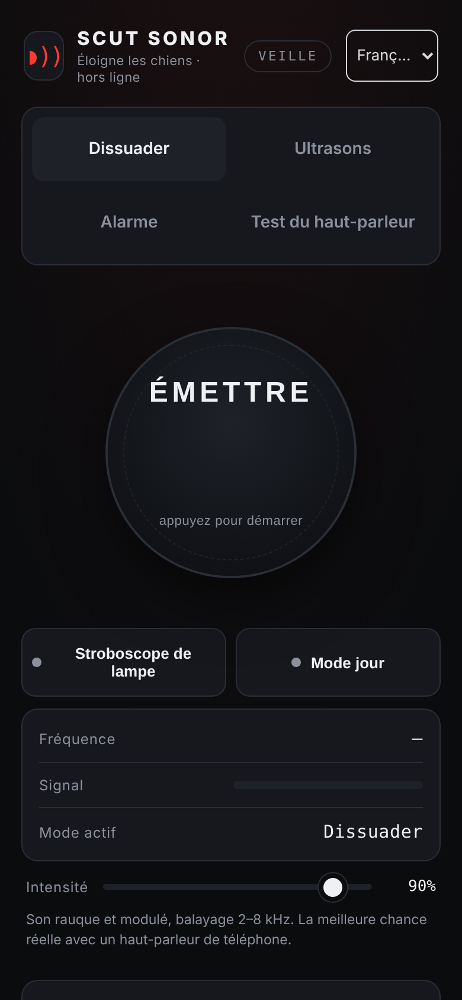

# SCUT SONOR

[English](README.md) · [Română](README.ro.md) · [Français](README.fr.md) · [Italiano](README.it.md) · [Español](README.es.md) · [Português](README.pt.md) · [Deutsch](README.de.md) · **Magyar**

Hangos hang, zseblámpa-villogás és biztonsági útmutató veszélyes kutyákkal való találkozáshoz, egyetlen offline HTML fájlban, követés nélkül.

**[Alkalmazás megnyitása →](https://scutsonor.chiuta.ro/)**

_Verzió: 2.2.0 · Utolsó frissítés: 2026-11-15_

| 1 | 2 | 3 |
|---|---|---|
|  |  |  |

## Képernyőképek

       

## Funkciók

- Négy mód: éles söprés 2–8 kHz, kísérleti ultrahang, kéthangú sziréna és hangszóróteszt, amely megmutatja, hol áll le a hangszóró.
- Zseblámpa-villogás (2,5 Hz, alacsony fényérzékenységi kockázat) – vizuális elriasztás, amely az emberek figyelmét is felkelti.
- Pattogásmentes felfutás, lágy vágású limiter a maximális hangerőért, bekapcsolva tartott kijelző, nagy kontrasztú nappali mód.
- Útmutató nyugodt viselkedéshez kutya vagy falka esetén, és hová jelents kóbor kutyákat.

## Használat

Nyisd meg az oldalt online, vagy töltsd le az `index.html` fájlt és nyisd meg egy friss böngészőben (Androidon a Chrome működik a legjobban). Telepítés és build nélkül.

## Korlátok

- A hang elriasztó hatásának bizonyítékai gyengék; ez segédeszköz, nem pajzs, és nem helyettesíti a biztonságos viselkedést vagy a 112 hívását.
- A telefonok hangszórói alig adják vissza az ~15–16 kHz feletti ultrahangot; a „Jel” sáv a generált jelet mutatja, nem a tényleges kimenetet.
- A felület 8 nyelven érhető el (RO, EN, FR, DE, ES, IT, HU, PT), az alkalmazás nyelvválasztójából; a fordítások gépi segítséggel készültek, anyanyelvi lektorálás nélkül.

## Adatvédelem

Minden a böngészőben fut; nincs fiók, nincs követés, nincsenek hálózati kérések, semmi nem tárolódik.

## Licenc

MIT © Alexandru-Ionuț Chiuță (Alexio)
