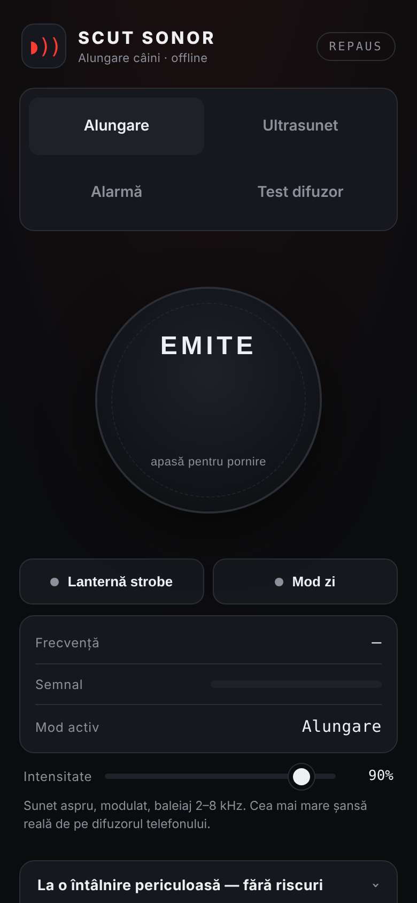
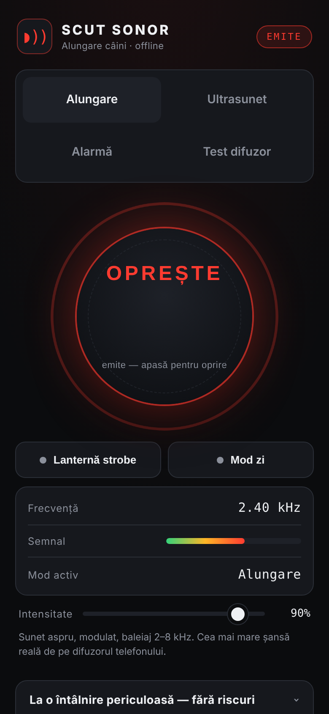

# SCUT SONOR

[English](README.md) · [Română](README.ro.md) · [Français](README.fr.md) · **Italiano** · [Español](README.es.md) · [Português](README.pt.md) · [Deutsch](README.de.md) · [Magyar](README.hu.md)

Suono potente, strobo della torcia e guida di sicurezza per incontri con cani pericolosi, in un unico file HTML offline, senza tracciamento.

**[Apri l’app →](https://scutsonor.chiuta.ro/)**

_Versione: 2.2.2 · Ultimo aggiornamento: 2026-11-17_

| 1 | 2 | 3 |
|---|---|---|
|  |  |  |

## Schermate

       

## Funzioni

- Quattro modalità: sweep aspro 2–8 kHz, ultrasuoni sperimentali, sirena a due toni e test dell’altoparlante che mostra dove si ferma.
- Strobo della torcia (2,5 Hz, basso rischio fotosensibile) – deterrente visivo che attira anche l’attenzione delle persone.
- Rampe senza click, limitatore soft-clip per il massimo volume, schermo sempre acceso, modalità giorno ad alto contrasto.
- Guida al comportamento calmo davanti a un cane o a un branco e dove segnalare i randagi.

## Uso

Apri la pagina online oppure scarica `index.html` e aprilo in un browser recente (Chrome su Android funziona meglio). Nessuna installazione, nessuna build.

## Limiti

- Le prove che il suono allontani i cani sono deboli; è un aiuto, non uno scudo, e non sostituisce un comportamento sicuro né la chiamata al 112.
- Gli altoparlanti dei telefoni riproducono male gli ultrasuoni oltre ~15–16 kHz; la barra «Segnale» mostra il segnale generato, non l’uscita reale.
- Interfaccia in 8 lingue (RO, EN, FR, DE, ES, IT, HU, PT), selezionabile dal selettore nell’app; traduzioni assistite da macchina, non riviste da madrelingua.

## Privacy

Tutto gira nel browser; nessun account, nessun tracciamento, nessuna richiesta di rete, nulla viene memorizzato.

## Licenza

MIT © Alexandru-Ionuț Chiuță (Alexio)
