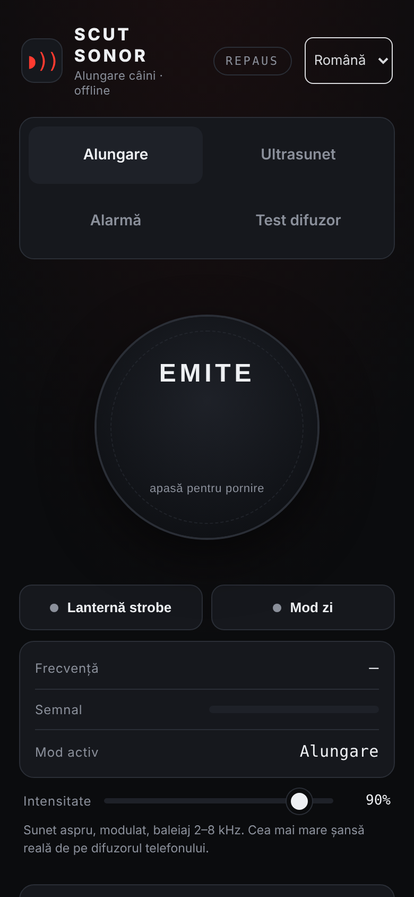
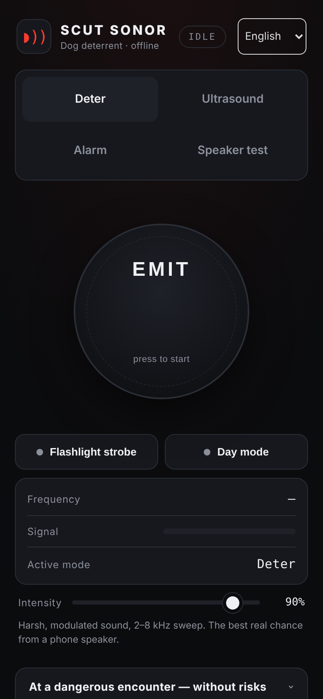
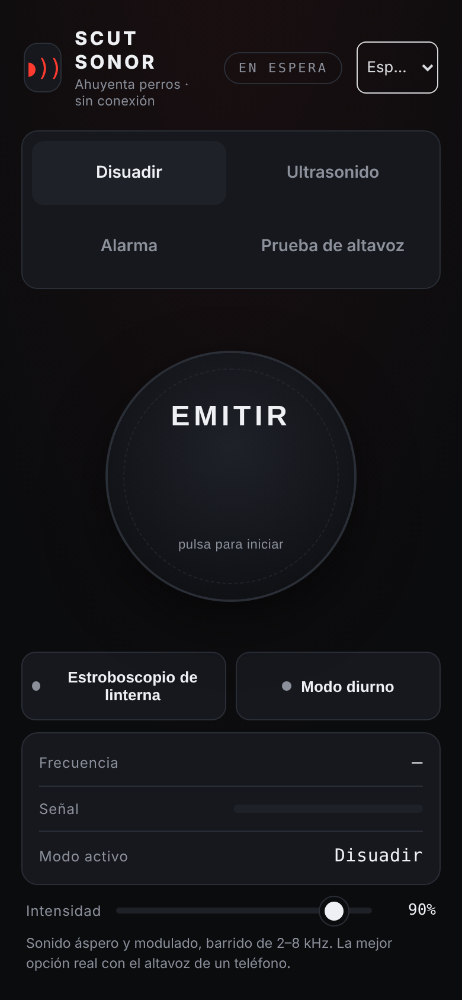
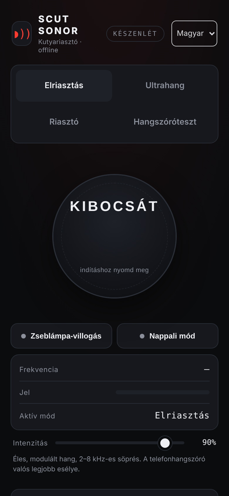

# SCUT SONOR

[English](README.md) · [Română](README.ro.md) · [Français](README.fr.md) · [Italiano](README.it.md) · [Español](README.es.md) · **Português** · [Deutsch](README.de.md) · [Magyar](README.hu.md)

Som potente, estroboscópio da lanterna e guia de segurança para encontros com cães perigosos, num único ficheiro HTML offline, sem rastreamento.

**[Abrir a aplicação →](https://scutsonor.chiuta.ro/)**

_Versão: 2.2.1 · Última atualização: 2026-11-15_

| 1 | 2 | 3 |
|---|---|---|
|  |  |  |

## Capturas de ecrã

       

## Funções

- Quatro modos: varrimento áspero 2–8 kHz, ultrassons experimentais, sirene de dois tons e teste do altifalante que mostra onde deixa de soar.
- Estroboscópio da lanterna (2,5 Hz, baixo risco fotossensível) – dissuasão visual que também chama a atenção das pessoas.
- Rampas sem estalidos, limitador de corte suave para volume máximo, ecrã aceso, modo dia de alto contraste.
- Guia de comportamento calmo perante um cão ou uma matilha e onde denunciar cães vadios.

## Utilização

Abra a página online, ou descarregue `index.html` e abra-o num navegador recente (Chrome no Android funciona melhor). Sem instalação nem build.

## Limites

- As provas de que o som afasta cães são fracas; é uma ajuda, não um escudo, e não substitui um comportamento seguro nem ligar ao 112.
- Os altifalantes dos telemóveis reproduzem mal ultrassons acima de ~15–16 kHz; a barra «Sinal» mostra o sinal gerado, não a saída real.
- Interface em 8 idiomas (RO, EN, FR, DE, ES, IT, HU, PT), à escolha no seletor da aplicação; traduções assistidas por máquina, não revisadas por falantes nativos.

## Privacidade

Tudo corre no seu navegador; sem conta, sem rastreamento, sem pedidos de rede, nada é guardado.

## Licença

MIT © Alexandru-Ionuț Chiuță (Alexio)
