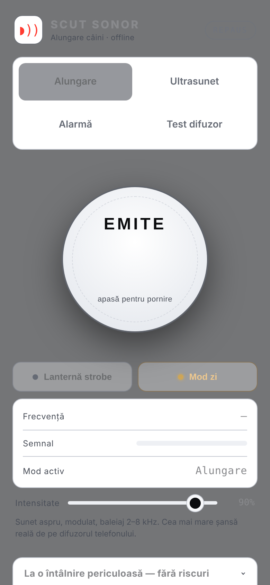
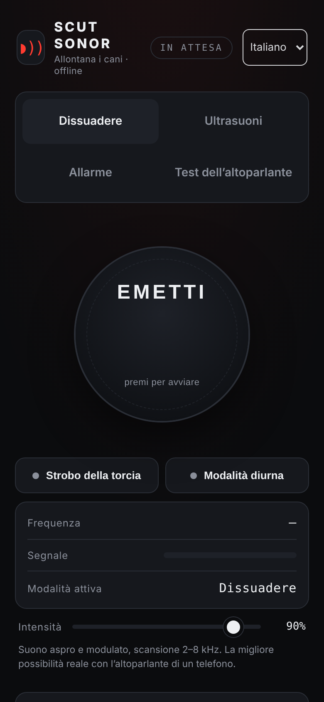

# SCUT SONOR

[English](README.md) · **Română** · [Français](README.fr.md) · [Italiano](README.it.md) · [Español](README.es.md) · [Português](README.pt.md) · [Deutsch](README.de.md) · [Magyar](README.hu.md)

Sunet puternic, strobe cu lanterna și ghid de siguranță pentru întâlniri cu câini periculoși, într-un singur fișier HTML, offline, fără urmărire.

**[Deschide aplicația →](https://scutsonor.chiuta.ro/)**

_Versiune: 2.2.3 · Ultima actualizare: 2026-11-20_

| 1 | 2 | 3 |
|---|---|---|
|  |  |  |

## Capturi de ecran

       

## Funcții

- Patru moduri: baleiaj aspru 2–8 kHz, ultrasunet experimental, sirenă pe două tonuri și test de difuzor care arată unde se oprește difuzorul telefonului.
- Strobe cu lanterna (2,5 Hz, risc fotosensibil redus) – deterent vizual care atrage și atenția oamenilor.
- Rampe fără pocnete, limitator soft-clip pentru tărie maximă, ecran aprins (Wake Lock), mod zi cu contrast ridicat.
- Ghid de comportament calm la un câine sau la o haită și unde sesizezi câinii fără stăpân.

## Utilizare

Deschide pagina online sau descarcă `index.html` și deschide-l într-un browser recent (Chrome pe Android merge cel mai bine). Fără instalare, fără build.

## Limite

- Dovezile că sunetul alungă câinii sunt slabe; e un ajutor, nu un scut, și nu înlocuiește comportamentul sigur sau apelul la 112.
- Difuzoarele de telefon redau slab ultrasunetul peste ~15–16 kHz; bara „Semnal” arată semnalul generat, nu ce iese din difuzor.
- Interfață în 8 limbi (RO, EN, FR, DE, ES, IT, HU, PT), aleasă din selectorul din aplicație; traducerile sunt asistate automat și nerevizuite de vorbitori nativi.

## Confidențialitate

Totul rulează în browser; fără cont, fără urmărire, fără cereri de rețea, nu se stochează nimic.

## Licență

MIT © Alexandru-Ionuț Chiuță (Alexio)
